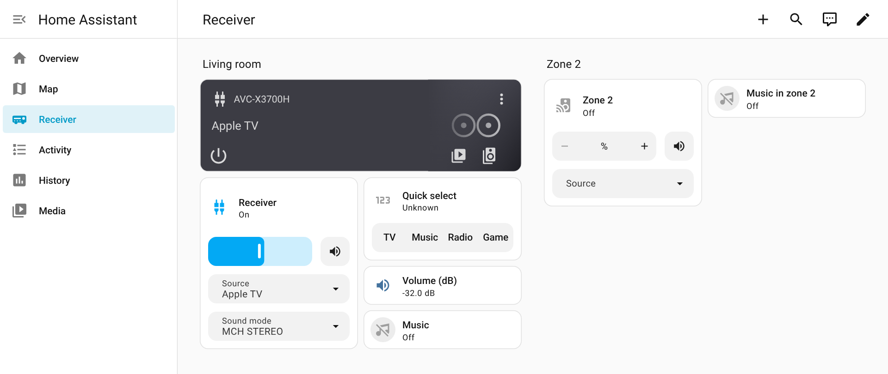

# Denon AVR Plus

**Your Denon or Marantz receiver in Home Assistant, completely.** Zones as
their own devices, sources and sound modes the way the receiver offers them,
Audyssey, speaker setup, video and graphic EQ, now playing over HEOS and from
the devices on its inputs, and live updates over the local network.

**[Install](#installation)** · **[User guide](docs/USER_GUIDE.md)** ·
**[Reference](docs/REFERENCE.md)** ·
**[Moving over from the official integration](docs/USER_GUIDE.md#8-move-over-from-another-denon-integration)**

## Why Denon AVR Plus

- **Everything the receiver can do, nothing it cannot.** Model, zones,
  inputs, speakers, sound modes and the settings a model has are read from
  the receiver; a setting appears only when the receiver has it.
- **Tidy by default.** What you change while listening starts enabled; setup
  settings wait on sub-devices (Audio, Video, Picture, Speakers, Graphic EQ),
  ready to switch on per group.
- **One player for the receiver and what plays on it.** Link the Apple TV,
  streamer or Chromecast on an input: the receiver's media player shows its
  title, cover and position, its buttons control it, and its library is in
  the receiver's media browser. If you like, the receiver switches to the
  input when the device starts playing and keeps the device at full volume.
  Music Assistant fits the same way: linked to the network input, its queue
  and library come with it.
- **Instant and robust.** Changes arrive the moment they happen. When the
  control connection drops, power, volume, mute and source keep working.
- **Safe to try.** It takes a receiver over from the official integration
  with its entity IDs and history, and hands it back with one click.
- **Your language, stable entity IDs.** Eight languages; entity IDs stay
  English, so examples and automations work everywhere.

## Compared with the official integration

Home Assistant ships **Denon AVR Network Receivers** (`denonavr`). Both can
be installed; only one should control a receiver at a time. As of November
2026 (Home Assistant core, `denonavr` library 1.3.3):

| | Official `denonavr` | Denon AVR Plus |
|---|---|---|
| **Installation** | Built in | Marketplace custom repository (HACS before 2026.11) |
| **Maintained by** | Home Assistant core maintainers, in every release | One maintainer, community project |
| **Receivers** | Denon and Marantz network receivers, including models before 2016 | HEOS generation (2016 and later); older models with fewer settings |
| **Connection** | HTTP poll every 10 s; telnet push optional (on for new setups) | Telnet push always; HTTP for discovery, a check and as fallback |
| **When telnet drops** | Falls back to the HTTP poll | Media players, sound mode, tone and Audyssey stay usable over HTTP; a repair explains what is wrong |
| **Entities** | One media player per zone | Media players plus selects, switches, numbers, sensors (an activity per zone: film, TV, music, radio, game), buttons and a remote, on sub-devices |
| **Zones** | Zone 2 and 3 as media players of the receiver | Each zone its own device, for its own room; zone 2 can join the main zone |
| **Sources** | As the receiver names them; option to show deleted ones | As the receiver names and hides them; per zone choice and renaming; quick selects and HEOS favorites in the list |
| **Sound modes** | One list, matched by the library; unknown modes as `sound_mode_raw` | Genre group and the modes the current signal allows, from the receiver; choice and renaming |
| **Volume** | 1 % per dB from −80 dB, at most +18 dB | 0–100 % over the receiver's range (or the official scale), plus a dB number; maximum, turn-on, step and announcement volume per zone |
| **Audyssey and audio** | Dynamic EQ as attribute and action | MultEQ, Dynamic EQ, Dynamic Volume, reference level, LFC, tone, dialogue and more as entities |
| **Speakers** | — | Levels, distances, crossovers, sizes, subwoofers, amp assign |
| **Video and HDMI** | — | Video mode, HDMI output and audio, HDMI setup (CEC, ARC), picture adjustment, signal sensors |
| **Graphic EQ** | — | Per channel and band, staged and applied at once |
| **Now playing** | Title, artist and cover of network sources | Over HEOS: cover, position, repeat, shuffle, queue, favorites and HEOS music in the media browser; text to speech and announcements |
| **Devices on the inputs** | — | A linked media player per input (an Apple TV, a streamer): its title, cover and buttons on the receiver's player; switch to its input when it starts, switch it on and off with the input, keep it at full volume, pause it when the zone is switched off; voice search finds its media (Music Assistant's library) |
| **Tuner** | — | Preset select and FM frequency |
| **Actions** | Raw HTTP command, Dynamic EQ, Audyssey refresh | Raw command, why no sound, volume ramp, snapshot and restore, tuner preset, HEOS queue; remote with the menu keys; device trigger; two blueprints |
| **Setup** | Discovery or address | Discovery or address; follows a new address by itself; reconfigure |
| **Help when something is off** | Log messages, diagnostics | A *Why no sound?* button per zone that names the cause and fixes power, mute and HDMI audio; repairs, diagnostics without addresses, a receiver test that puts every setting back, the reason when the receiver keeps a setting, firmware updates under Settings → Updates |
| **Languages** | Home Assistant's translations | Eight languages, English entity IDs |

Not every function is equally proven: some commands come from the `denonavr`
library's documentation and are not yet tried on a receiver; the
[reference](docs/REFERENCE.md) says which.

**Which one fits?** The official integration, if a media player per zone is
all you need, if you prefer what comes built in, or for a receiver from
before 2016. Denon AVR Plus, if you want the receiver's settings, zones in
their own rooms, or HEOS playback in the same place. Switching is reversible:
[move over](docs/USER_GUIDE.md#8-move-over-from-another-denon-integration)
and back without losing entity IDs or history.

## Supported receivers

Denon and Marantz AV receivers from 2010 on. The integration reads each
receiver's generation, brand and functions from the receiver itself, so it
needs no list of models.

| Generation | Examples | Works |
|---|---|---|
| 2016 on, with HEOS | Denon AVR-X…00H, AVR-S…H, AVC; Marantz SR…12 and newer, NR…08 and newer, AV, Cinema | Everything; tested on AVR-X3600H and AVR-X2600H |
| 2014–2016, without HEOS | Denon AVR-X…100W to X…300W, AVR-S…W; Marantz SR…09 to SR…11, NR…05 to NR1607 | Everything except HEOS and the setup web interface |
| 2013 | Denon AVR-X…000, AVR-E…00; Marantz SR…08, NR…04 | As 2014–2016; tested on AVR-X2000 |
| 2010–2012 | Denon AVR-1912, AVR-3311CI; Marantz SR6006, SR7005 … | As 2013, read like the official integration does; not tested on a receiver yet |

Details, what differs per generation and Marantz's differences:
[Compatibility](docs/COMPATIBILITY.md). Testing a receiver is optional;
to confirm an untested model, [test it](CONTRIBUTING.md#test-the-receiver)
and share the result.

## Installation

**Home Assistant 2026.11 and newer** (the Marketplace replaced HACS):

1. As an administrator, open Settings → **Marketplace** → **Add from link**
   and enter `johnnyh1975/ha_denonavr_plus`. Adding a repository that is not
   in the catalog needs a GitHub connection; the dialog asks for it.
2. Open **Denon AVR Plus** → **Install**. If Home Assistant asks for a
   restart, restart it from the repair under Settings → System → Repairs.
3. Add the receiver: it usually shows up under Settings → Devices & services
   → **Discovered**.

**Home Assistant 2026.8 to 2026.10:** in [HACS](https://hacs.xyz/), add this
repository as a [custom repository](https://hacs.xyz/docs/faq/custom_repositories),
category **Integration**, install **Denon AVR Plus** and restart. An existing
HACS installation moves to the Marketplace by itself when you update to
2026.11.

Without either, copy `custom_components/denonavr_plus` into your
configuration's `custom_components` folder and restart.

Needs Home Assistant 2026.8 or newer, network standby on the receiver and,
across VLANs, ports 23 and 8080 open
([checklist](docs/USER_GUIDE.md#1-before-you-start)).

## Get started

1. **[Add the receiver](docs/USER_GUIDE.md#2-add-the-receiver)**: nothing to
   type but its address, if it was not discovered.
2. **[Find your way around](docs/USER_GUIDE.md#3-find-your-way-around)**: the
   receiver, its zones and sub-devices.
3. **[Tailor it](docs/USER_GUIDE.md#5-tailor-it-in-the-options)**: volume
   limits, sources and sound modes, the settings you want to see.
4. **[Link the devices on its inputs](docs/USER_GUIDE.md#playback)**: an
   Apple TV or a streamer, so one card shows and controls what you hear.
5. **[Automate it](docs/USER_GUIDE.md#6-automations-that-work-well)**: the
   blueprints for "TV on, receiver on" and a night mode.

## Documentation

| Document | Read it when |
|---|---|
| **[User guide](docs/USER_GUIDE.md)** | You set up and use the receiver: step by step, with screenshots and recommended settings. Start here. |
| [Compatibility](docs/COMPATIBILITY.md) | You want to know whether your receiver works and what differs by generation. |
| [Reference](docs/REFERENCE.md) | You look up an entity, option, action, port or limitation. |
| [Upgrading](docs/UPGRADING.md) | You update, or move over from another Denon integration. |
| [Contributing](CONTRIBUTING.md) | You test a receiver model, report a problem or change code. |
| [Release notes](release-notes/) | You want to know what changed in a version. |
| [Protocol](docs/protocol/README.md) | You want to know how the receivers talk, per generation. |

## Origin

Denon AVR Plus is based on **[Denon AVR](https://github.com/LaserGuruGuy/denon_avr)
by [LaserGuruGuy](https://github.com/LaserGuruGuy)** (MIT licence), version 1.1.2.
The full commit history of that project is preserved in this repository. Its
copyright notice is kept in [LICENSE](LICENSE). This project is not affiliated
with or endorsed by LaserGuruGuy; please report problems with Denon AVR Plus
here, not upstream.

## Credits

With thanks to **Denon** for publicly documenting the AV Receiver control
protocol, which made this independent implementation possible. Denon's
official documentation is available at <https://manuals.denon.com/>.

For the official, first‑party Home Assistant integration for these receivers,
see **Denon AVR Network Receivers**:
<https://www.home-assistant.io/integrations/denonavr/>.

## Trademarks and acknowledgements

This is an independent, unofficial project. It is **not affiliated with, endorsed
by, sponsored by, or supported by** any of the companies below. All product and
company names, logos, and brands are the property of their respective owners and
are used here for identification purposes only (nominative use); their use does
not imply any affiliation or endorsement.

- **Denon**, **Marantz**, and **HEOS** are trademarks of D&M Holdings Inc. —
  <https://www.denon.com>
- **Audyssey**, **Audyssey MultEQ**, **MultEQ XT32**, **Dynamic EQ**,
  **Dynamic Volume**, and **LFC (Low Frequency Containment)** are trademarks of
  Audyssey Laboratories, Inc. — <https://audyssey.com>
- **Dolby**, **Dolby Audio**, **Dolby Surround**, and **Dolby Atmos** are
  trademarks of Dolby Laboratories, Inc. — <https://www.dolby.com>
- **DTS**, **DTS Neural:X**, and **DTS Virtual:X** are trademarks of DTS, Inc.,
  a Xperi company — <https://dts.com>
- **HDMI**, the HDMI logo, and **High‑Definition Multimedia Interface** are
  trademarks of HDMI Licensing Administrator, Inc. — <https://www.hdmi.org>
- **Home Assistant** and the Home Assistant logo are trademarks of the Open Home
  Foundation — <https://www.openhomefoundation.org>
- **HACS** (Home Assistant Community Store) — <https://hacs.xyz>

Any other product or company names mentioned are the trademarks of their
respective owners.
