# Denon AVR Plus – user guide

This guide walks through Denon AVR Plus the way you use it: getting the
receiver in, finding your way around, daily use, tailoring it, automations,
testing a model, moving over from another Denon integration, voice assistants
and Apple Home, and what to do
when something does not work. Each section starts with what you get from it
and ends with the recommended setting.

The [reference](REFERENCE.md) lists every entity, option and action; this
guide links to it where details matter. The [README](../README.md) compares
Denon AVR Plus with the official integration.

> The screenshots come from Home Assistant 2026.10 talking to a simulated
> AVC-X3700H ([tools/simulate_receiver.py](../tools/simulate_receiver.py)),
> which answers with what real receivers sent. Names, numbers and the
> settings a model offers differ on your receiver.

**Contents**

1. [Before you start](#1-before-you-start)
2. [Add the receiver](#2-add-the-receiver)
3. [Find your way around](#3-find-your-way-around)
4. [Everyday use](#4-everyday-use)
5. [Tailor it in the options](#5-tailor-it-in-the-options)
6. [Automations that work well](#6-automations-that-work-well)
7. [Test a receiver model](#7-test-a-receiver-model)
8. [Move over from another Denon integration](#8-move-over-from-another-denon-integration)
9. [With Music Assistant](#9-with-music-assistant)
10. [Voice assistants and Apple Home](#10-voice-assistants-and-apple-home)
11. [Troubleshooting](#11-troubleshooting)

---

## 1. Before you start

Four things decide whether the receiver runs smoothly. Check them once, on
the receiver and on your network:

| Check | Why | Where |
|---|---|---|
| **Network standby on** | Only then does a receiver in standby answer on the network, so Home Assistant can turn it on. | Receiver menu: Setup → Network → **Network Control** (older models: **IP Control**), set to *Always On*. |
| **A fixed address** | Home Assistant follows a new address by itself, but a fixed one avoids gaps. | Your router: a DHCP reservation for the receiver. |
| **One integration at a time** | Many receivers accept only one control connection (telnet). Two integrations on the same receiver disturb each other. | Coming from another Denon integration? Let Denon AVR Plus [take it over](#8-move-over-from-another-denon-integration). |
| **Ports 23 and 8080 open** | Telnet (23) carries control and live updates, HTTP (8080, or 80 before 2016) discovery. | Only if Home Assistant and the receiver are in different VLANs: allow these from Home Assistant to the receiver. The optional ports are in the [reference](REFERENCE.md#network-ports-and-protocols). |

Then install Denon AVR Plus from the Marketplace (HACS before Home Assistant
2026.11) and restart Home Assistant (see
[Installation](../README.md#installation)).

## 2. Add the receiver

Receivers on your network usually show up under **Settings → Devices &
services → Discovered**; select **Add** there. Otherwise add it by hand:

1. **Settings → Devices & services → Add integration**, search for
   **Denon AVR Plus**.

   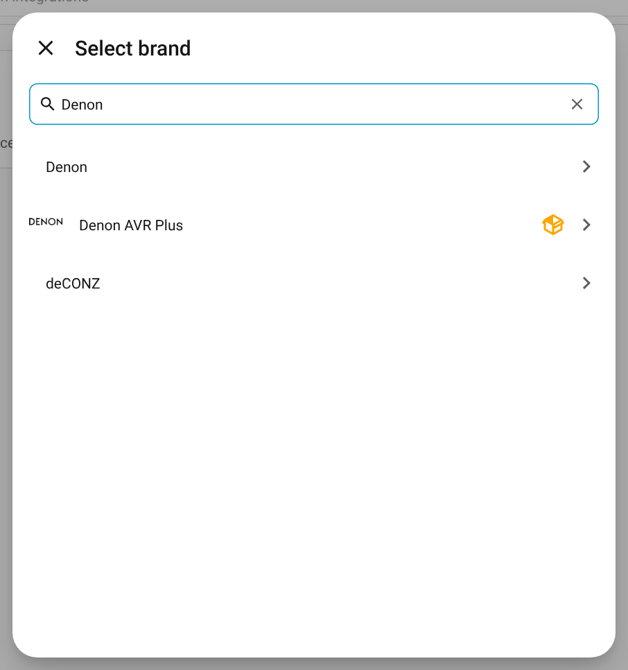

2. Enter the receiver's **IP address** and select **Submit**. Leave the
   field empty to pick from the receivers Home Assistant has found. Nothing
   else is asked: model, zones, inputs, sound modes and functions are read
   from the receiver.

   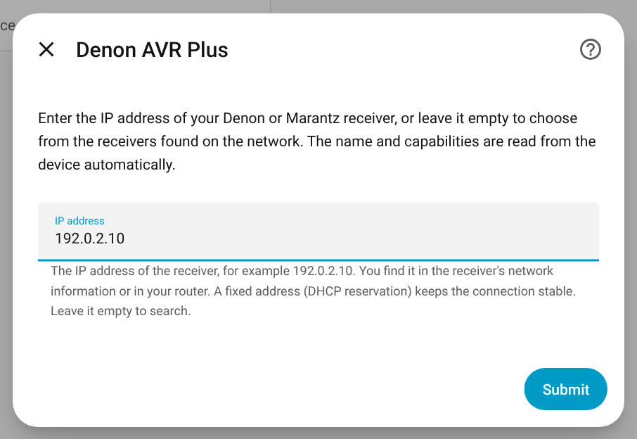

   If the receiver answers on the network but not on its control
   connection (telnet, port 23), setup says so and names the usual causes:
   another integration or program holding the receiver's one control
   connection, the AVR Remote app with its tuner screen open, a firewall
   rule. Remove the cause and select **Check again**, or **Continue without
   it for now**: the integration then works over the web interface and
   connects by itself once the port is free. A receiver that does not answer
   at all is often in standby with Network Standby off.

3. **Only for a device that is not a described AV receiver** (a system such
   as a network CD receiver, or a generation not seen yet), you are asked
   whether to test it after setup. Leave the toggle on: the test only reads
   at first and puts back everything it changes (see
   [Test a receiver model](#7-test-a-receiver-model)). Every Denon or
   Marantz AV receiver from 2010 on skips this step
   ([Compatibility](COMPATIBILITY.md)).

4. Put the devices in their rooms. The receiver comes with **sub-devices**
   for its setup menus (Audio, Video, Picture, Speakers, Graphic EQ) and one
   per additional zone.

   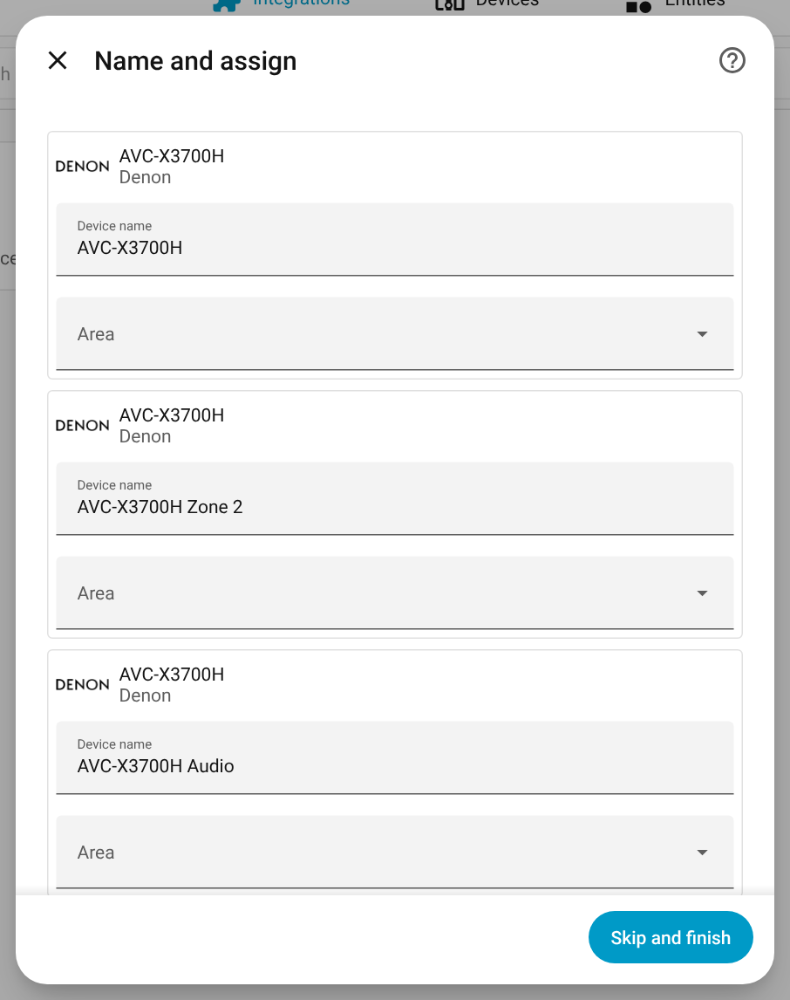

> **Recommended:** give the **receiver** its room and **Zone 2** the room it
> plays in. Leave the sub-devices empty: they follow the receiver's room,
> also when you move it later.

If the receiver is already set up in the official Denon integration or in
Denon AVR, you are asked first whether to take it over: see
[section 8](#8-move-over-from-another-denon-integration).

## 3. Find your way around

The integration entry lists the receiver and its sub-devices. The gear
(**Configure**) opens the options, the menu (⋮) has **Reconfigure** (a new
address) and **Download diagnostics**.

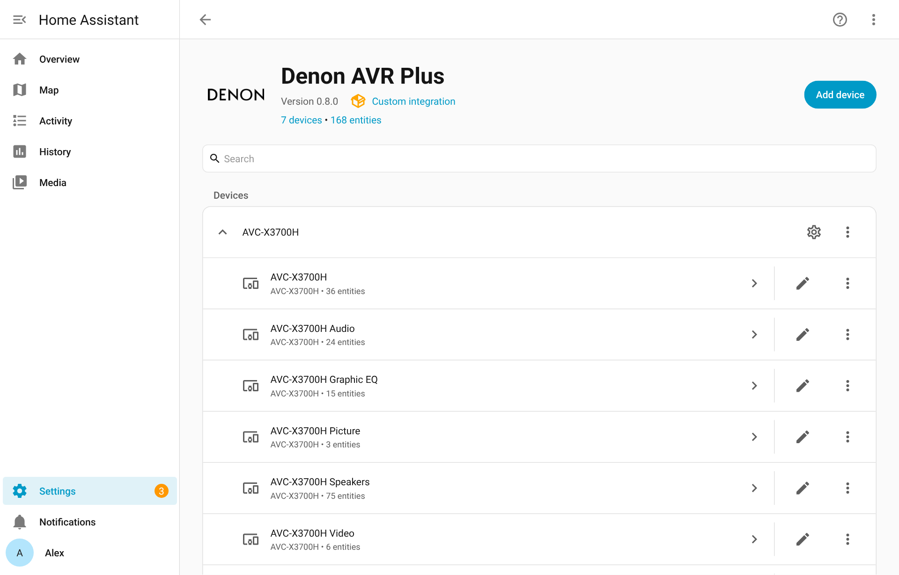

The **receiver device** holds what you use while listening: the media
player, volume in dB, source and sound mode, quick selects, the Network
Music switch, dimmer, sleep timer and the tuner. The settings of the receiver's
setup menus sit on the sub-devices, the way the receiver groups them.

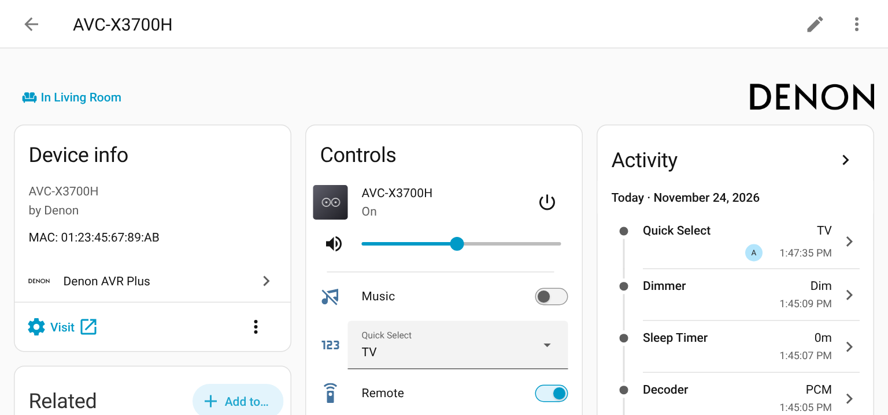

A receiver has well over a hundred settings, so **only the everyday ones
start enabled**. Speaker setup, video and HDMI setup, picture adjustment,
the graphic EQ, volume limits and the fast-changing signal sensors are
there but hidden. Show a single one from its device page (*+N disabled
entities*), or a whole group at once from the options (see
[Entities](#entities)). The full list is under
[Enabled and disabled entities](REFERENCE.md#enabled-and-disabled-entities).

Two things work differently from what you might expect:

- **Entity IDs are English** in every language, for example
  `switch.avc_x3700h_audio_dynamic_eq`, so examples and shared automations
  fit every installation.
- **Some settings depend on the signal.** The receiver ignores, for example,
  Dynamic Compression without a Dolby or DTS signal and the video settings
  without a picture. A change that does not stick is usually that, not an
  error.

## 4. Everyday use

The media player is the receiver's remote in Home Assistant: power, volume,
mute, source and sound mode. On network sources it shows title, artist and
cover and takes play, pause and skip; on other inputs it shows the input with
its own artwork, the sound mode and the signal (for example
`PCM · 44.1 kHz`).

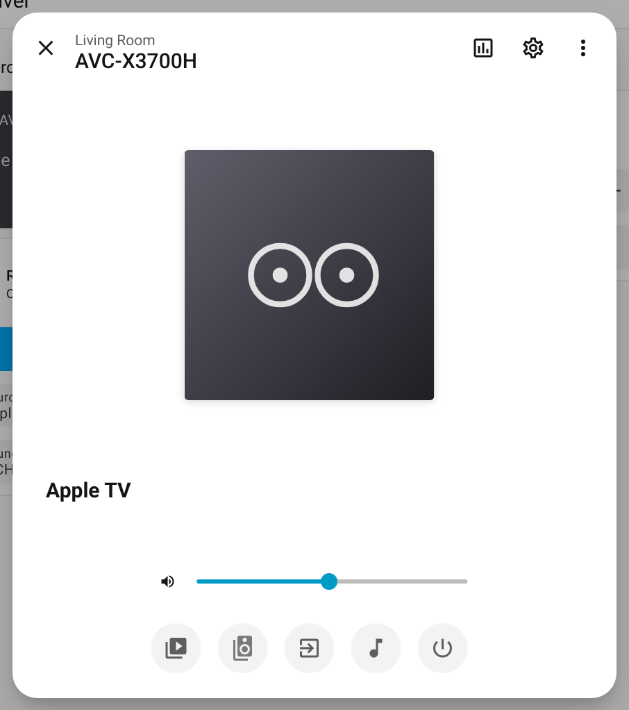

For a dashboard, start from the
[example view](../examples/dashboard.yaml): paste it into a dashboard's raw
configuration editor and replace `avr_x2600h` with your receiver's entity
IDs. It uses Home Assistant's own cards only.

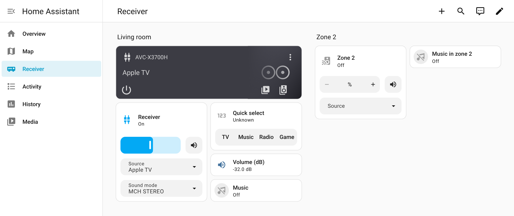

What makes it work well, and what to keep when you build your own:

- **The media control card on top** shows what plays, with the input's
  artwork when there is no cover.
- **One tile with the player's features** (volume slider, source, sound
  mode) replaces a row of separate controls.
- **Quick selects as buttons.** A quick select sets input, sound mode and
  volume in one go, as stored on the receiver. Name them on the receiver
  (TV, Music, Radio, Game) and they get these names here; four short names
  fit as buttons.
- **The volume in dB** next to the player's percent: it is the number the
  receiver's display shows.
- **The tuner only while it plays.** Its preset and frequency are unknown
  otherwise; the example hides the section then. Choosing a preset switches
  the receiver to the tuner.
- **Zone 2 in its own section**, with the room it plays in.

Voice works too: "play TV on the living room receiver" finds quick
selects, inputs and HEOS favorites by name.

## 5. Tailor it in the options

**Configure** on the integration entry opens the options. Apart from **Test
the receiver**, nothing here changes the receiver itself; it changes what
Home Assistant shows and does.

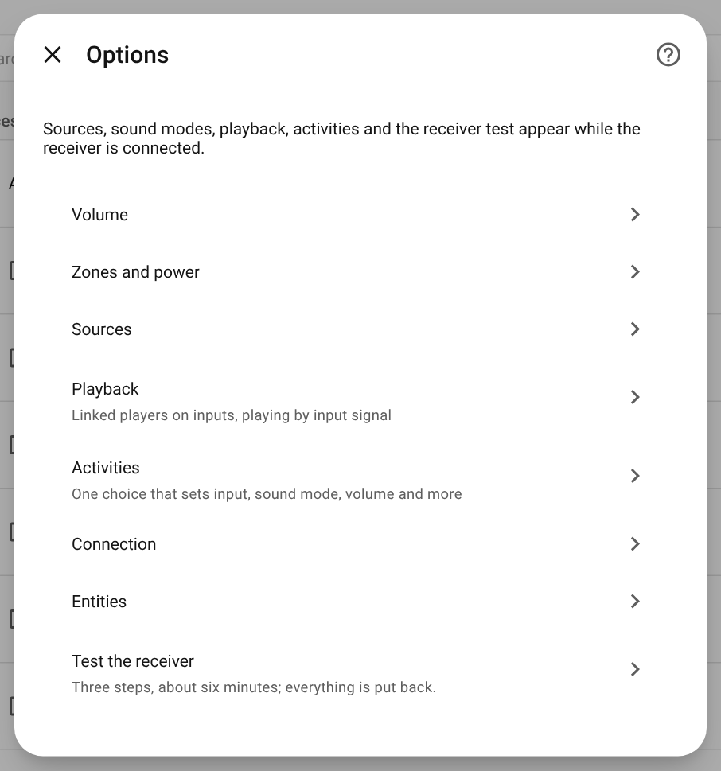

### Volume

Per zone, in dB as the receiver shows it.

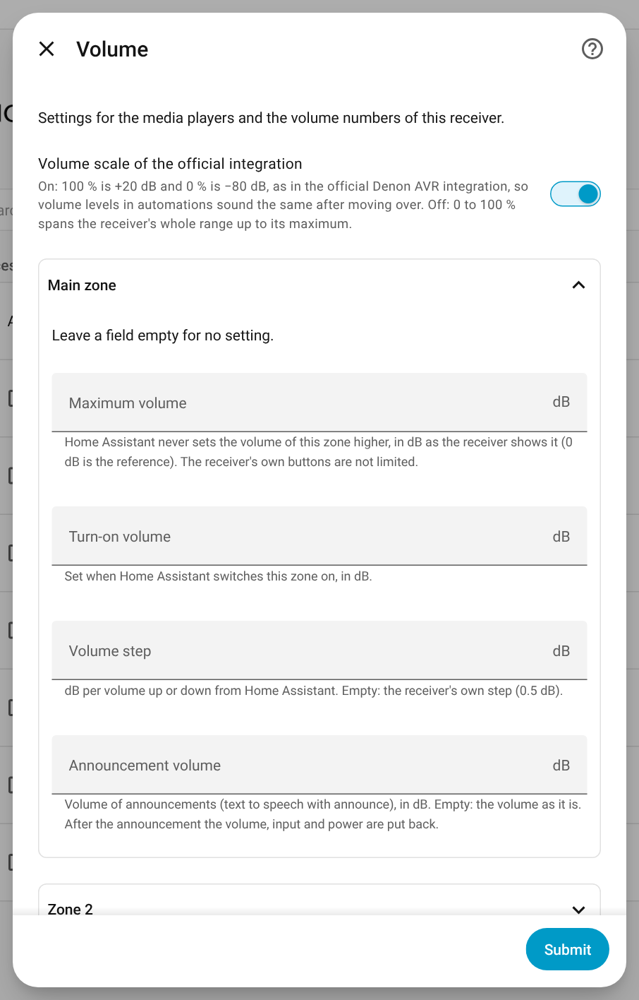

> **Recommended:**
> - Set a **maximum volume** for every zone. Home Assistant never goes above
>   it, whether from a slider, a voice command or an automation with a
>   mistake. The receiver's own buttons and remote are not limited; for
>   them, use the receiver's Volume Limit.
> - Set a **turn-on volume** for zones that are switched on by automations,
>   so the receiver does not start at last night's party level.
> - Leave **Volume scale of the official integration** off, unless you
>   moved over from the official integration (the move switches it on).

### Zones

Which additional zones get a device with its entities, and whether turning
the main zone off puts the whole receiver in standby. Switch off a zone
you do not use: its device and entities go away, and come back when you
switch it on again.

### Sources and sound modes

Per zone, which inputs the media player offers and how they are called;
which sound modes the main zone offers. Names and hidden inputs set on the
receiver are taken over already. Sound modes show short names (Dolby
Surround instead of the receiver's Dolby Audio - DD + DSur); switch
**Readable names** off to see the receiver's names.

> **Recommended:** hide the inputs nobody uses. Rename on the **receiver**
> when you want the same names on its display; rename here when only Home
> Assistant should show them. Automations keep working with the receiver's
> names either way. Upper or lower case does not matter, and an input can also
> be chosen by its code (`AUX2`). A name that matches nothing gets an error
> that lists the choices.
>
> **Zone 2:** smaller receivers play no HDMI input in Zone 2 (an
> AVR-X2600H stays silent), only analog inputs, the tuner and network
> sources. After setup a repair asks once which inputs Zone 2 can play, with
> the HDMI inputs deselected when the receiver reports no HDMI for Zone 2.
> When Zone 2 does not switch to an input, Home Assistant says so and takes
> that input out of the Zone 2 list here, where you can put it back. Which
> inputs are HDMI depends on how they are assigned on the receiver.

### Entities

A toggle per group of the entities that start hidden, with how many each
holds. Shown entities appear within half a minute. An entity you enabled or
disabled yourself stays as it is.

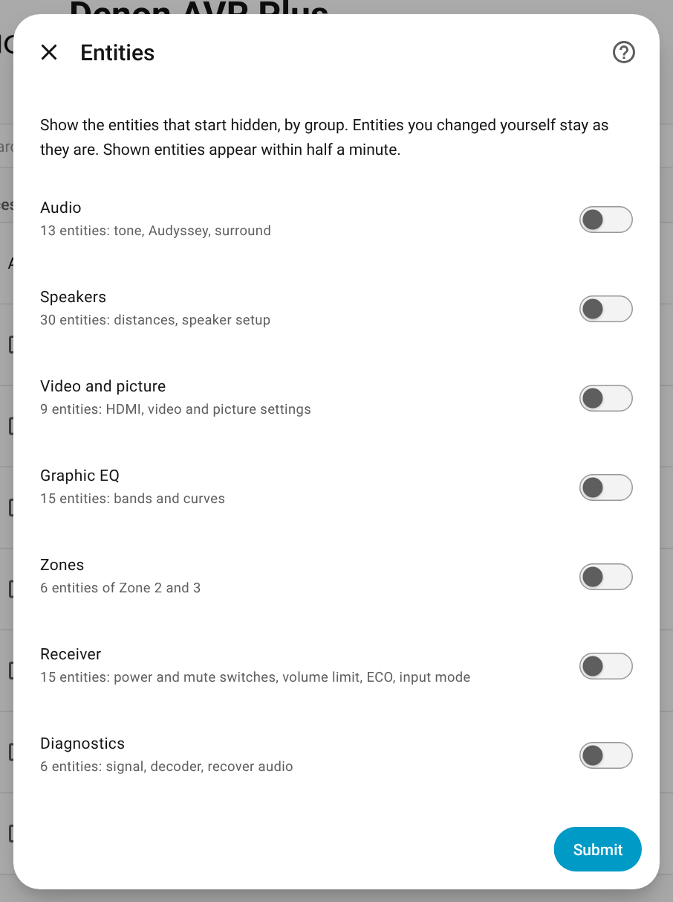

> **Recommended:** show **Audio** if you adjust Audyssey, tone or surround
> parameters from Home Assistant, **Speakers** only while you set up the
> speakers. Keep **Diagnostics** off unless you look into a problem: its
> sensors change with every track and fill the history.

### Connection

How often the receiver is checked over HTTP, whether now playing comes over
HEOS, and how often the setup settings (graphic EQ, video setup) are read.
The defaults suit almost every installation; turn HEOS off only if another
program needs that connection.

## 6. Automations that work well

Two blueprints cover the most common ones; import them under
**Settings → Automations & scenes → Blueprints → Import** with the file's
GitHub address:

- [TV on, receiver on](../blueprints/automation/denonavr_plus/tv_on.yaml):
  when the TV turns on, the receiver's zone follows with the TV's input and,
  if you like, a sound mode and a volume. When the TV turns off, the zone
  turns off, but only if it still plays the TV.
- [Night mode](../blueprints/automation/denonavr_plus/night_mode.yaml):
  between two times the volume stays below a limit, and Dynamic Volume can
  switch to a night setting and back.

Good practice for your own:

- **No waiting for the receiver to wake up** before choosing the input:
  selecting a source or a sound mode on a zone in standby turns it on
  first.
- **Use quick selects for scenes** (`select.select_option` on the quick
  select): one command, and the receiver applies input, sound mode and
  volume as you stored them.
- **Set exact levels with the dB number** (`number.set_value` on
  `number.<receiver>_volume`) rather than the player's percent.
- **For a doorbell or an announcement** on a receiver with HEOS, play it as
  an announcement (`announce`, as `tts.speak` and voice assistants do):
  power, input, volume and mute come back by themselves afterwards. For your
  own sequences, `denonavr_plus.snapshot` and `denonavr_plus.restore` do the
  same.
- **Raw commands** (`denonavr_plus.send_command`) only for what has no
  entity; they are not checked against what the receiver can do.
- **Receiver without network standby?** Build an automation on the device
  trigger **Turn on requested while the receiver does not answer** that
  switches it on by infrared or HDMI-CEC (see
  [Device trigger](REFERENCE.md#device-trigger-turn-on-requested)).

## 7. Test a receiver model

The receiver test finds out what your model does with this integration:
which settings it reports and which commands it confirms. It is optional:
run it to confirm a model that is not tested yet, after a firmware update,
or when a setting does not behave as expected. It starts from **Configure →
Test the receiver**, or, for a device that is not a described AV receiver,
from the repair *"<model>: receiver type not described yet"*.

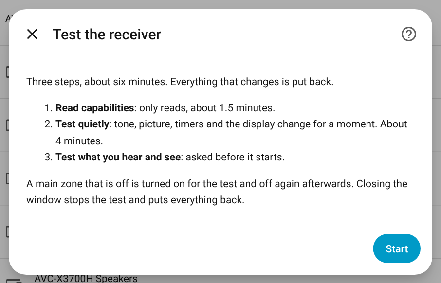

It has three steps and takes about six minutes:

1. **Read capabilities** only reads.
2. **Test quietly** changes tone, picture, timers and the display for a
   moment and puts each back. The page names the part of the receiver it is
   working on.

   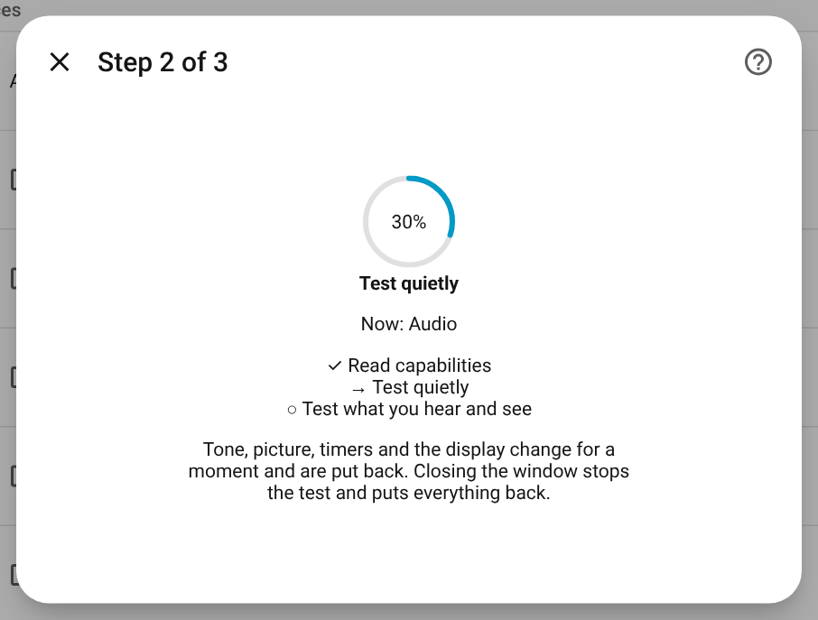

3. **Test what you hear and see** (mute, speakers, HDMI output, tuner,
   Zone 2, the setup menu on the TV) is asked first. Stay in front of the
   TV for it, or skip it.

   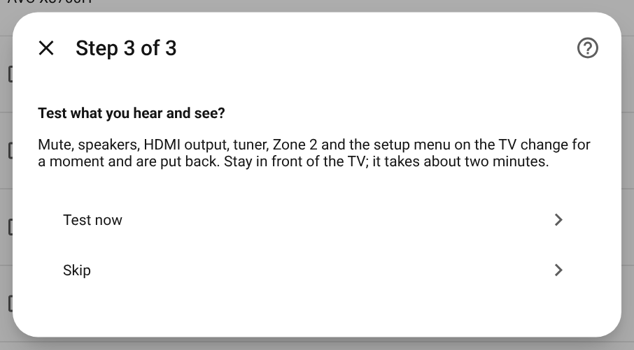

A main zone that is off is turned on for the test and off again afterwards.
Closing the window stops the test and puts everything back. If the receiver
stops answering, the test writes nothing more, waits for it and puts back
what is still changed.

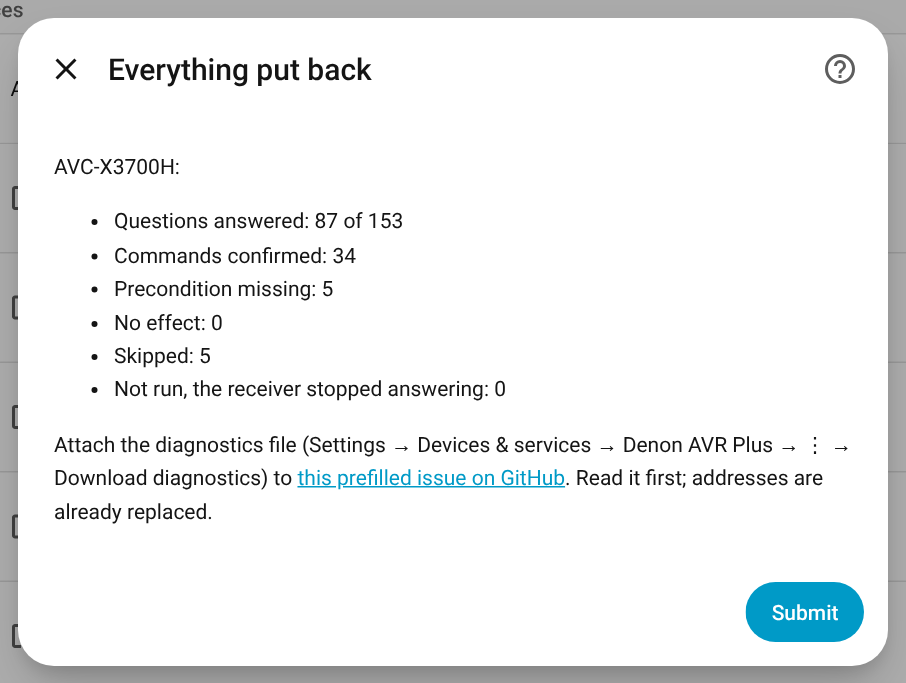

Reading the result:

- **Commands confirmed**: the receiver took the setting and reported it back.
- **Precondition missing**: the setting needs something the test does not
  change on its own, for example MultEQ off for the graphic EQ, or Zone 2
  on.
- **No effect**: the receiver ignored it. Usually the current signal or
  sound mode: a run with a film playing (Dolby or DTS sound and a picture
  through the receiver) tests more.
- If the title says **Check the receiver** instead of *Everything put back*,
  it lists the settings to set back by hand.

> **Recommended:** attach the diagnostics file to the receiver report the
> result links to (in GitHub Discussions, with model, firmware and version
> filled in where GitHub takes them over). Read it before you send it; addresses, MAC and serial
> number are replaced. That is how a model becomes *checked*.

## 8. Move over from another Denon integration

A receiver set up in the official **Denon AVR Network Receivers**
integration or in **Denon AVR** (LaserGuruGuy) is offered for the move when
you add it, found by its address, MAC or serial number:

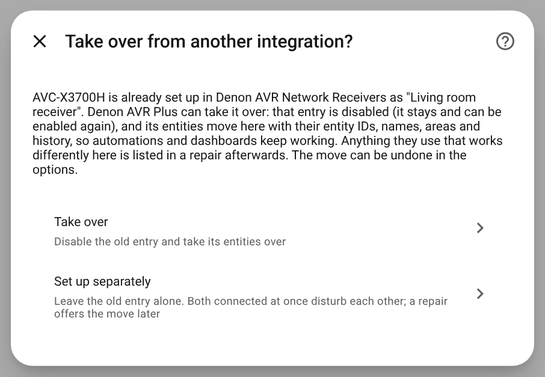

**Take over** does this:

- The other entry is **disabled**, not deleted, so both no longer disturb
  each other on the one control connection.
- Its entities **move here and keep their entity IDs**, names, rooms and
  history: dashboards, automations and the history graphs go on as before.
  From the official integration these are the zones' media players; from
  Denon AVR every entity Denon AVR Plus still has.
- From the official integration, the volume scale of the official
  integration is switched on, so `volume_set` levels sound the same.

Chose *Set up separately*, or added Denon AVR Plus earlier? While the other
integration still runs the receiver, a repair offers the move.

Afterwards a repair lists the automations and scripts that use something of
the official integration that works differently here, each with what
replaces it. Nothing in them is changed; adjust them, then confirm.

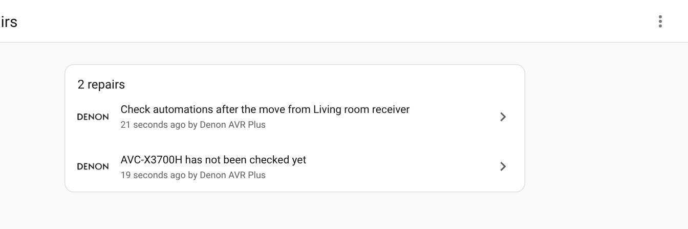

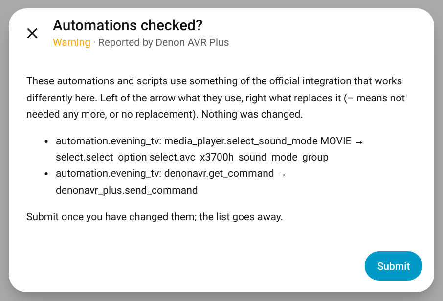

To go back, **Configure → Undo the move**: the entities return to the old
integration with their entity IDs, its entry is enabled again, and Denon
AVR Plus is disabled.

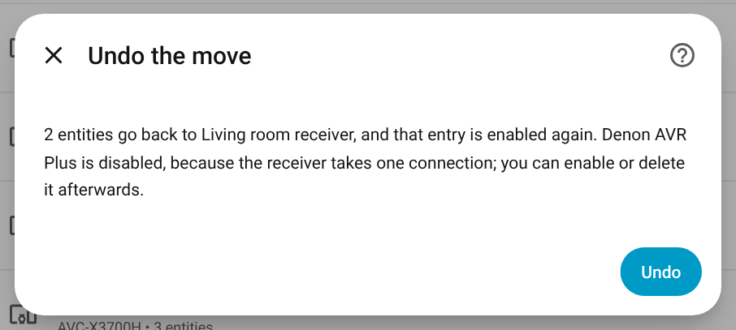

## 9. With Music Assistant

Music Assistant plays your library and streaming services on the receiver
through its HEOS or AirPlay provider; Denon AVR Plus does the rest (power,
input, volume, sound mode, zones).

> **Recommended:** use the zone's **Network Music** switch as the power control of
> the Music Assistant player. It switches the zone on and to the network
> input to play, and off when the music stops, but never ends a film that
> runs on another input. Volume can stay on the media player of this
> integration.

Who does what, including the HEOS integration, is in the
[reference](REFERENCE.md#with-music-assistant-and-the-heos-integration).

## 10. Voice assistants and Apple Home

Each zone is a media player of the device class *receiver*. Assistants and
Apple Home show it as a receiver: on and off, volume and mute, and the inputs
of its source list. What they understand depends on the names you give.

| Assistant | What works | Names |
|---|---|---|
| **Assist** (Home Assistant) | On, off, volume, mute, pause and resume by the built-in sentences | Give the zone an alias you say easily ("Wohnzimmer Receiver"). For an input, expose a script that calls *Select media player source* and say the script's name. |
| **Google Assistant** | On, off, volume, input by name ("set the input on … to Apple TV") | Any input name; keep them short and distinct. |
| **Alexa** | On, off, volume, input | Alexa knows only a fixed set of input names, such as HDMI 1 to HDMI 10, TV, CD, Phono, Tuner, Game, Blu-ray, DVD, Media Player, Satellite and AUX 1 to AUX 7. Give inputs such names under **Sources** if Alexa should switch them. |
| **Apple Home** (HomeKit Bridge) | On, off and the input in the Home app and by Siri; volume through the Remote in Control Center | Add each zone in **accessory mode**, one HomeKit Bridge entry per media player; in a shared bridge it shows as a plain switch. |

> **Recommended:** hide the inputs nobody uses and rename the rest to what you
> say out loud (**Configure → Sources**); every assistant reads the same list.
> Expose the main zone and the zones you really speak to, not all of them.
> Settings such as Dynamic EQ are switches and selects of their own; expose
> only the few you change by voice.

## 11. Troubleshooting

| What you see | Likely cause | What to do |
|---|---|---|
| The receiver cannot be added (*cannot connect*) | It is off without network standby, or port 8080 is blocked. | Turn it on, check [network standby](#1-before-you-start), allow port 8080 from Home Assistant. |
| Repair *"… does not accept a control connection"*; only power, volume, mute, source and (from 2013) the sound mode, tone and Audyssey settings work, with a delay | Another integration or program holds the one telnet connection (the Denon or Marantz AVR Remote app too, while its tuner screen is open), or port 23 is blocked. | Disable the other integration (or [move over](#8-move-over-from-another-denon-integration)), close the app's tuner screen; allow port 23. |
| Repair *"… reports control by apps switched off"* | The receiver answers `NSARA OFF`: control by the remote app is off on the receiver. Not yet seen on a receiver. | If settings from Home Assistant have no effect, switch control by apps on again in the receiver's setup menu; a report with the diagnostics helps. |
| The receiver cannot be turned on from Home Assistant | Network standby is off, so in standby it is not on the network. | Turn network standby on, or use the device trigger with infrared or HDMI-CEC. |
| Everything is unavailable for a moment, then back | The receiver stopped answering; Denon AVR Plus opens a new connection after 10 seconds. | Nothing; if it happens often, check the network to the receiver. |
| A setting jumps back right after you change it, or an error says the receiver kept it | The receiver takes it only for some signals, sound modes or settings, and none in standby; the error names the condition. | Meet the condition and try again (for example Dynamic Compression with Dolby sound); the [reference](REFERENCE.md#notes-and-limitations) lists them. |
| A sound mode you expect is missing | The receiver offers only the modes that fit the current signal. | Play the signal it is for; the list follows. |
| An entity you need is not there | It starts hidden. | Device page → *+N disabled entities*, or **Configure → Entities**. |
| New texts are missing or show raw keys after an update | The app keeps the old texts. | Reload the browser page or restart the companion app. |

Still stuck? Open an issue on GitHub with your model, its firmware version
and the diagnostics file (**⋮ → Download diagnostics** on the integration
entry). Download it right after the problem shows: it holds the last 300
lines sent to and received from the receiver.
